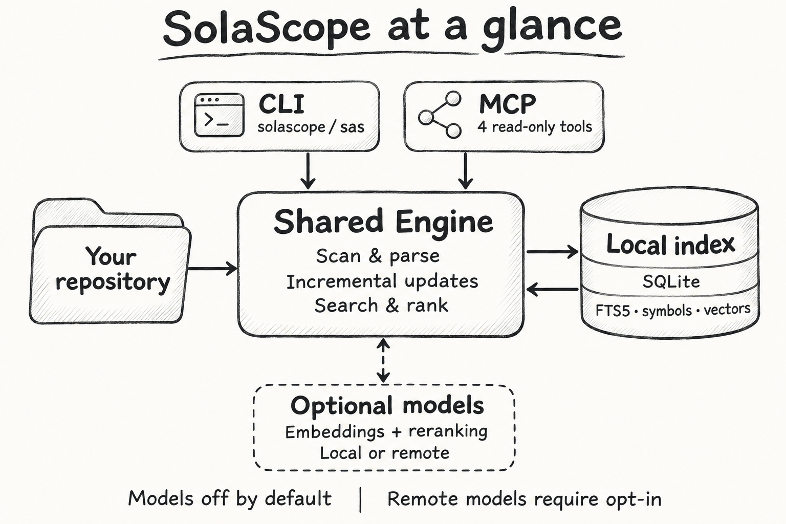
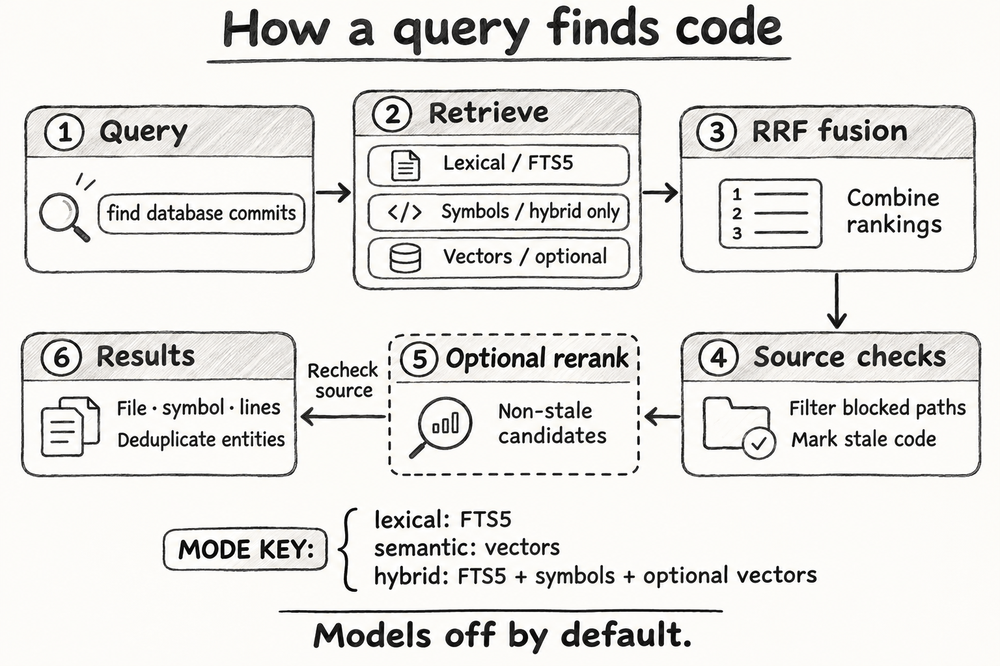

# SolaScope

English | [简体中文](README.zh-CN.md)

Local-first code search that turns a question, symbol name, keyword, or error message into a file, symbol, and line range. Use it from the terminal with `solascope` or `sas`, or connect an assistant through the MCP server.

SolaScope works without a model. SQLite FTS5 and symbol lookup provide the default search; optional embeddings and reranking add model-based retrieval.

- **Incremental indexing.** Reparse changed files and request embeddings only for uncached inputs.
- **Source locations.** Results include relative paths, symbols, line ranges, snippets, and a `stale` flag when the source changes.
- **Structured parsing.** Tree-sitter extracts definitions from Rust, Python, JavaScript/JSX, TypeScript/TSX, and Go. Other text can use line-based chunks.
- **Independent model providers.** Choose embedding and reranking services separately, including Ollama, OpenAI-compatible APIs, DashScope, SiliconFlow, and optional local ONNX reranking.
- **One search engine.** The CLI, MCP server, and benchmark tools share the same indexing and retrieval implementation.

Current version: **0.1.1**. See [support and limitations](docs/implementation-status.md) for the tested scope.

## Architecture at a glance



The illustration shows the earlier read-only MCP surface and omits the current `index` and `reindex` maintenance tools. The CLI and MCP server share one engine and index. Indexing scans and parses source locally; model adapters are optional. See the [architecture](docs/architecture.md) for publication, caching, and consistency details.

## Install

### Windows: no development environment required

Run this in PowerShell or Command Prompt to execute the [remote installer](https://raw.githubusercontent.com/wchiway/SolaScope/main/install.ps1) directly:

```powershell
powershell -c "irm https://raw.githubusercontent.com/wchiway/SolaScope/main/install.ps1|iex"
```

The script runs in a child PowerShell process without saving an installer file. It tracks remote `main` and installs binaries from a [published release](https://github.com/wchiway/SolaScope/releases).

The installer targets Windows 10/11 x64 and uses built-in Windows PowerShell 5.1. No Rust, Git, Node.js, Python, package manager, or administrator privileges are required. It installs both entry points into `%LOCALAPPDATA%\Programs\SolaScope\bin`, updates only User PATH, and preserves existing configuration. Online mode requires GitHub access; offline ZIP/checksum installation, version selection, upgrades, and policy/verification boundaries are described in the [installation guide](docs/installation.md). Reopen terminals and IDEs after installation. Windows release builds statically link the CRT and check DLL imports; clean-machine runtime validation remains separate.

### Linux and macOS: precompiled installation

Execute the [remote installer](https://raw.githubusercontent.com/wchiway/SolaScope/main/install.sh) directly without saving an installer file:

```sh
curl --proto '=https' --tlsv1.2 -fsSL https://raw.githubusercontent.com/wchiway/SolaScope/main/install.sh | sh
# Optional: select a published version and binary directory.
curl --proto '=https' --tlsv1.2 -fsSL https://raw.githubusercontent.com/wchiway/SolaScope/main/install.sh | sh -s -- --version 0.1.1 --bin-dir "$HOME/.local/bin"
```

These commands execute the script from remote `main`; installation still downloads the binary archive from a published release.

Both `solascope` and `sas` install into `~/.local/bin` by default. The script needs a POSIX shell, standard Unix utilities, tar/gzip, a SHA-256 tool, and curl or wget for online downloads. No development environment or sudo is needed. It verifies checksums and staged versions, supports offline installation and upgrade rollback, and prints a PATH reminder without editing shell profiles or configuration. Linux packages require x86_64 glibc; macOS Intel/Apple Silicon detection selects only targets actually published in that release. See the [installation guide](docs/installation.md#linux-and-macos) for platform limits and options.

### Self-update

```sh
solascope update
sas update --check
```

Both names update `solascope` and `sas` together in the running executable's directory. The updater resolves the latest stable GitHub Release, verifies SHA-256 and staged versions, and preserves configuration and indexes. It never downgrades a newer version; `--force` reinstalls the same version. No sudo or remote installer script is invoked. Stop existing MCP/watch sessions before updating on Windows; old running binaries may leave a reported backup directory to remove after those processes exit. See [self-update details](docs/installation.md#self-update).

### Build from source

Install both CLI entry points from a local checkout:

```bash
cargo install --path apps/solascope --locked
```

Development and validation use Rust 1.99; older toolchains have not been tested. SQLite is bundled, so no database service is required. Cargo installs both binaries into its bin directory, normally `~/.cargo/bin`; make sure that directory is on `PATH`.

To build without installing:

```bash
cargo build --release --locked -p solascope-cli --bins
```

The binaries are written to `target/release/`. `solascope` and `sas` accept the same commands and options and produce the same output.

## Quick start

Run these commands in the repository you want to search:

```bash
solascope init
solascope index
sas search "where are database transactions committed"
sas status
```

`init` creates a user configuration file and leaves an existing file untouched:

| Platform | User configuration |
| --- | --- |
| Linux / macOS | `~/.solascope/.solascope.toml` |
| Windows (PowerShell) | `$env:USERPROFILE\.solascope\.solascope.toml` |

It does not create a project configuration or bind the user defaults to the current repository. You can run `index` directly with the built-in defaults: it recursively scans the **current working directory and all levels of subdirectories**, subject to ignore rules and privacy filters. An explicit positional path takes precedence over `--root`, followed by the process environment variable `SOLASCOPE__PROJECT__ROOT`; otherwise the current directory is used without expanding to a parent Git root.

A project `.solascope.toml` can supply settings, including one discovered in a parent directory or selected with `--config`. Its location and any `project.root` value in TOML or a sibling `.env` do not select the source directory. `project.index_dir` controls only where index data is stored. Search, status, and watch use the same directory selection rules.

Create an optional project ignore file:

```bash
solascope ignore
# Equivalent: sas ignore
```

This creates `.solascopeignore` in the project root with commented gitignore-style examples, without overwriting an existing file. Use `ignore /path/to/project` or `ignore --root /path/to/project` to select another root. Edit the file to exclude files or directories; see the [ignore-file reference](docs/configuration.md#ignore-files) for syntax and privacy restrictions.

Keep the index up to date while editing:

```bash
solascope index --watch
```

Results identify a relative path, a 1-based line range, a symbol when available, a score, and a source snippet. After changing source files, run `index` again or leave a watcher running.

## CLI

| Command | Purpose |
| --- | --- |
| `update [--check] [--force]` | Check or install the latest stable GitHub Release for both entry points |
| `init [--probe]` | Create user defaults; optionally probe the configured models |
| `ignore [path]` | Create `.solascopeignore` in the project root without overwriting existing rules |
| `index [path] [--rebuild] [--probe]` | Recursively index the current directory or an explicit path; rebuild all chunks when requested |
| `index [path] --watch` | Index once, then watch for changes; `--no-watch` overrides `index.watch` |
| `search <query>` | Search code with optional embeddings and reranking |
| `symbol <name> [--kind K]` | Find definitions by exact, prefix, substring, or limited fuzzy matching |
| `context <path>[:line]` | Read current source, up to 200 lines or 64 KiB |
| `status` | Show the index generation, counts, relocated vectors, and model fingerprint |
| `watch [path] [--probe]` | Watch and incrementally update an index |
| `mcp [--probe]` | Start the stdio MCP server; lookup tools are read-only, with explicit index maintenance tools |
| `doctor [--models] [--prune-cache]` | Check configuration and index consistency, probe models, or prune unused cache entries |

Common options include `--root`, `--config`, `--json`, `--limit` (1–100), `--mode lexical|semantic|hybrid`, `--path`, `--no-rerank`, and `--verbose`.

- `lexical` retrieves from FTS5.
- `semantic` retrieves from vectors and requires an embedding provider.
- `hybrid` combines lexical, symbol, and optional vector results with reciprocal rank fusion (RRF).

Reranking can be enabled independently of the retrieval mode. With `--json`, stdout contains one JSON result; warnings and errors go to stderr, and progress follows the log configuration. In watch mode, only the initial indexing report is written to stdout.

Exit codes: `0` success, `1` internal/storage/I/O error, `2` invalid input or configuration, `3` missing or outdated index, `4` model failure or incompatibility, `5` writer lock conflict, and `130` interruption.

## How search works



The selected mode determines which retrieval channels run. Source checks filter blocked paths and mark stale code before reranking, then run again afterward. Reranking uses non-stale candidates, and final results are deduplicated by entity. See the [search pipeline](docs/architecture.md#search-pipeline).

## Models and configuration

Embedding and reranking are disabled by default. Enable either through the user configuration or a project override:

| Capability | Providers |
| --- | --- |
| Embeddings | `ollama`, `openai`, `remote`, `dashscope`, `siliconflow` |
| Reranking | `remote`, `openai`, `dashscope`, `siliconflow`, `fastembed` |

HTTP model providers require `privacy.remote_opt_in = true`, except for Ollama on a loopback address. The reranking provider named `openai` supports a vendor-compatible request format; check the service's reranking API before configuring it. Local `fastembed` reranking requires a build with `--features local-rerank`, a compatible ONNX Runtime, and model files.

Store API keys in a `.env` beside the configuration file, using variable names such as `DASHSCOPE_API_KEY` and `SILICONFLOW_API_KEY`. The TOML configuration references those names through `api_key_env`. Existing process variables take precedence. Restart a watcher or MCP server after changing `.env`.

CLI diagnostics are also appended to `logs/solascope.log` beside the active configuration, normally `~/.solascope/logs/solascope.log` on Linux/macOS or `$env:USERPROFILE\.solascope\logs\solascope.log` on Windows. Retry status and final failures are recorded with credentials redacted. Set `log.persist = false` to keep stderr only.

The [configuration reference](docs/configuration.md) covers every field, precedence rule, provider protocol, and setup example.

An embedding index is bound to a fingerprint of the provider, model, endpoint, dimensions, normalization, and input template. After changing the embedding setup, rebuild the index:

```bash
solascope index --rebuild
```

Changing the reranker or rotating an API key does not require a rebuild. Parser configuration changes trigger reparsing on the next indexing run. Read-only queries report an outdated index instead of migrating it.

## MCP integration

From the project directory, build an index and start the server:

```bash
solascope index
solascope mcp
```

Alternatively, start `solascope mcp` without pre-indexing and authorize an MCP `index` call when requested.

A client configuration can use:

```json
{
  "mcpServers": {
    "solascope": {
      "command": "solascope",
      "args": ["mcp"]
    }
  }
}
```

The server exposes four read-only lookup tools (`search_code`, `find_symbol`, `get_code_context`, and `index_status`) plus `index` and `reindex` for explicitly authorized, one-shot index maintenance. Every tool accepts an optional `root` to select a project directory; omitted or `null` uses the server's startup default, and each project's index defaults to its `.solascope/` directory. MCP indexing applies the project's privacy settings, writer lock, and atomic publication; configured remote embeddings may send source and incur charges. Startup does not create or update an index, and MCP tools do not provide watch mode. Context reads current source without an index. See [MCP integration](docs/mcp.md) for authorization, parameters, reports, and recovery.

## Privacy

The built-in defaults use no models and send no code to a model service. Enabling remote embeddings or reranking can send indexed code snippets to the configured provider.

Source access stays within the project root and follows ignore rules. Sensitive paths, including `.env` files, private keys, and credential directories, are always excluded from indexing and source-context reads. API keys are referenced by environment-variable name and redacted from application diagnostics. Endpoints cannot contain credentials, query strings, or fragments; model HTTP clients do not follow redirects.

The index contains source snippets and is stored in the project's `.solascope/` directory by default. Keep it out of version control and shared artifacts. See the [configuration reference](docs/configuration.md#privacy) for the full privacy settings and excluded paths.

## Documentation and development

- [Configuration](docs/configuration.md)
- [MCP integration](docs/mcp.md)
- [Architecture](docs/architecture.md)
- [Benchmark guide](benchmarks/README.md) and [recorded measurements](docs/benchmarks.md)
- [Support and limitations](docs/implementation-status.md)

```bash
cargo test --workspace --all-targets --locked
cargo test --workspace --all-targets --locked --features local-rerank
cargo clippy --workspace --all-targets --locked -- -D warnings
cargo fmt --all -- --check
```

GitHub Actions is configured to run workspace formatting, Clippy, default tests, and package tests on Linux, macOS, and Windows, with `local-rerank` tests in a separate Linux job. After all checks pass, a reusable workflow builds both CLI binaries and packages them with public documentation and `SHA256SUMS`: `.tar.gz` on Unix, `.zip` on Windows, named by version and Rust target. Runs reuse Rust dependency caches and cancel superseded runs.

Pushing a version tag such as `v0.1.1` automatically validates that it matches the workspace version and belongs to `main` history, runs the reusable CI/package workflow on that exact commit, and publishes a **GitHub Release** after all assets are verified. Unix archives include `install.sh` and the Windows ZIP includes `install.ps1`/`install.cmd`; all three installers are also exported as standalone assets. Combined `SHA256SUMS` covers the three archives and three installer files, giving seven assets including the checksum file. The description uses the DeepSeek Responses API (`deepseek-flash` by default) when the repository secret `DEEPSEEK_API_KEY` is configured; missing credentials or provider failures retain a factual changelog. Existing releases/tags are never overwritten. See [release operations](docs/releases.md) for configuration, tag-based retries, privacy, prereleases, and verification boundaries. Publishing to crates.io is not configured.

Release-tooling tests can also run locally with Python 3.11 or newer:

```bash
python -I -B -m unittest discover -s .github/scripts -p 'test_*.py' -v
```

Linux CLI builds, automated tests, and repeated offline installation of a locally built real Unix release archive have been exercised. Unix installer transport and macOS/Rosetta detection use command fixtures on Linux; actual macOS installation and public-release downloads still need validation. Windows installer offline fixtures have run with Windows PowerShell 5.1, without changing the real User PATH. Model protocol and DeepSeek description tests use local fixtures/mocks. Live model quality, local ONNX inference, macOS/Windows CLI release execution on clean machines, commercial MCP clients, remote CI packages, live DeepSeek generation, and GitHub Release publication still need validation.

## License

[Apache License 2.0](LICENSE).
