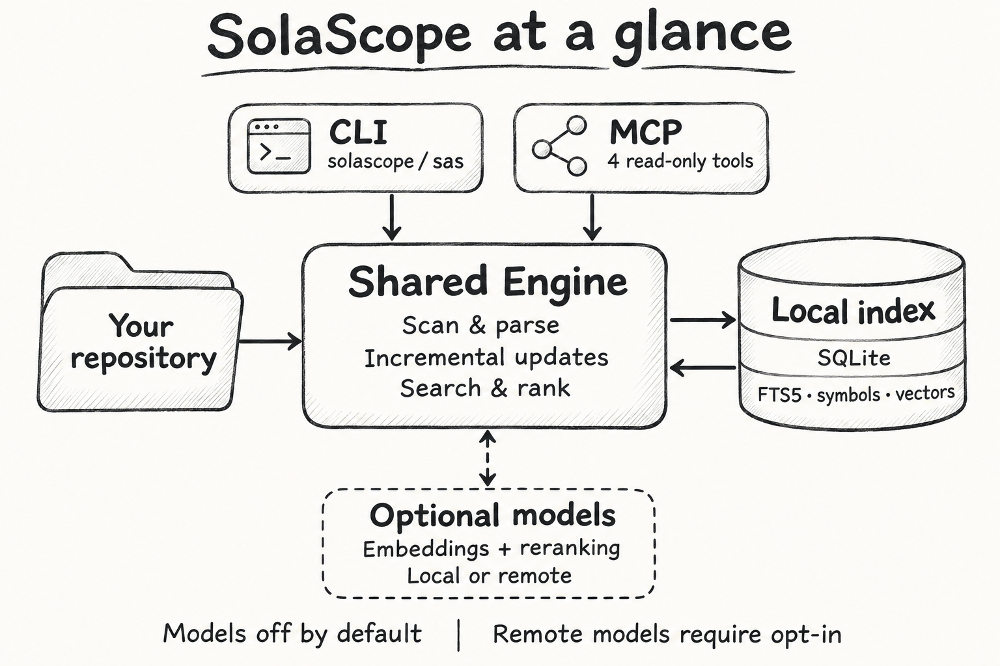
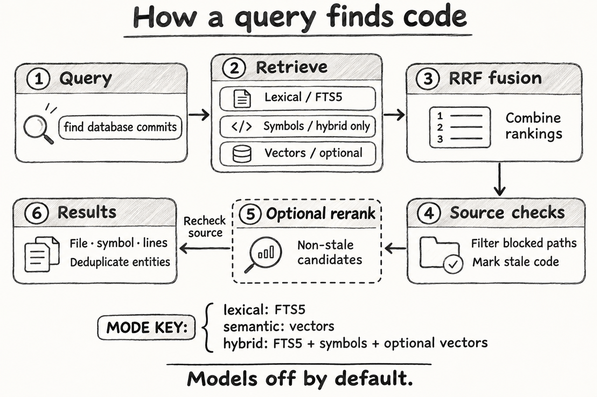

# SolaScope

[English](README.md) | 简体中文

本地优先的代码搜索工具，将自然语言问题、符号名、关键词或报错信息定位到文件、符号和代码行。可以通过 `solascope` / `sas` 命令行使用，也可以通过只读 MCP 服务接入助手。

SolaScope 无需模型即可运行。默认使用 SQLite FTS5 和符号检索，也可独立启用 Embedding 与重排。

- **增量索引**：只重新解析变化的文件，只为未命中缓存的输入请求向量。
- **源码定位**：结果包含相对路径、符号、行区间和片段；源码变化后标记 `stale`。
- **结构化解析**：使用 Tree-sitter 提取 Rust、Python、JavaScript/JSX、TypeScript/TSX 和 Go 定义，其他文本可按行分块。
- **独立模型配置**：Embedding 与重排分别选择服务，支持 Ollama、OpenAI 兼容接口、百炼 DashScope、硅基流动，以及可选的本地 ONNX 重排。
- **共用检索引擎**：CLI、MCP 和评测工具使用同一套索引与检索实现。

当前版本：**0.1.0**。已验证范围见[支持与限制](docs/implementation-status.md)。详细文档使用英文。

## 架构概览



CLI 与 MCP 共用同一引擎和索引。扫描与解析在本地完成，模型适配器按需启用。图中标注为英文，索引发布、缓存和一致性细节见[架构文档](docs/architecture.md)。

## 安装

在本地源码目录安装两个 CLI 入口：

```bash
cargo install --path apps/solascope --locked
```

开发与验证使用 Rust 1.99，更早的工具链尚未测试。SQLite 随程序编译，无需数据库服务。Cargo 默认将两个入口安装到 `~/.cargo/bin`，请确保该目录在 `PATH` 中。

只构建、不安装：

```bash
cargo build --release --locked -p solascope-cli --bins
```

产物位于 `target/release/`。`solascope` 和 `sas` 的命令、参数及输出一致。

## 快速开始

在需要搜索的项目目录中运行：

```bash
solascope init
solascope index
sas search "where are database transactions committed"
sas status
```

`init` 创建用户配置，已有文件保持不变：

| 平台 | 用户配置 |
| --- | --- |
| Linux / macOS | `~/.solascope/.solascope.toml` |
| Windows | `$USERPROFILE/.solascope/.solascope.toml` |

它不会创建项目配置，也不会将用户默认值绑定到当前项目。可以直接执行 `index` 使用内置默认值：默认递归扫描**执行命令时的当前目录及所有层级的子目录**，仍遵循忽略规则和隐私过滤。显式目录的优先级为命令位置参数、`--root`、进程环境变量 `SOLASCOPE__PROJECT__ROOT`；均未指定时使用当前目录，不自动扩大到上级 Git 根。

项目 `.solascope.toml` 用于提供设置，也可以从上级目录发现或用 `--config` 指定。配置文件所在位置及 TOML / 同目录 `.env` 中的 `project.root` 都不改变扫描目录。`project.index_dir` 只指定索引数据保存位置。搜索、状态和监听使用相同的目录选择规则。

开发时持续更新索引：

```bash
solascope index --watch
```

结果包含项目相对路径、从 1 开始的行区间、可用的符号名、分数和源码片段。源码修改后重新执行 `index`，或保持监听进程运行。

## 命令行

| 命令 | 用途 |
| --- | --- |
| `init [--probe]` | 创建用户配置；可选探测已配置的模型 |
| `index [path] [--rebuild] [--probe]` | 递归索引当前目录或显式路径；可选全量重建 |
| `index [path] --watch` | 首次索引后持续监听；`--no-watch` 覆盖 `index.watch` |
| `search <query>` | 搜索代码，可使用向量和重排 |
| `symbol <name> [--kind K]` | 按精确、前缀、包含或有限拼写纠错查找定义 |
| `context <path>[:line]` | 读取当前源码，最多 200 行或 64 KiB |
| `status` | 显示索引代际、数量、路径复用向量及模型指纹 |
| `watch [path] [--probe]` | 监听文件变化并增量索引 |
| `mcp [--probe]` | 启动只读 stdio MCP 服务 |
| `doctor [--models] [--prune-cache]` | 检查配置和索引一致性，探测模型或清理未引用缓存 |

通用参数包括 `--root`、`--config`、`--json`、`--limit`（1–100）、`--mode lexical|semantic|hybrid`、`--path`、`--no-rerank` 和 `--verbose`。

- `lexical` 使用 FTS5 召回。
- `semantic` 使用向量召回，需要配置 Embedding。
- `hybrid` 使用倒数排名融合（RRF）组合词法、符号和可选向量结果。

各检索模式均可独立启用重排。使用 `--json` 时，stdout 只输出一个 JSON 结果；警告和错误写 stderr，进度遵循日志配置。监听模式只将首次索引报告写到 stdout。

退出码：`0` 成功，`1` 内部、存储或 I/O 错误，`2` 参数或配置错误，`3` 索引缺失或过旧，`4` 模型失败或不兼容，`5` 写入者锁冲突，`130` 中断。

## 检索流程



检索模式决定启用哪些召回通道。源码检查会过滤被禁止的路径并标记过期代码，在重排后再次执行；重排只使用非过期候选，最终结果按实体去重。图中标注为英文，细节见[检索流水线](docs/architecture.md#search-pipeline)。

## 模型与配置

Embedding 和重排默认禁用，可通过用户配置或项目覆盖启用：

| 能力 | provider |
| --- | --- |
| Embedding | `ollama`、`openai`、`remote`、`dashscope`、`siliconflow` |
| 重排 | `remote`、`openai`、`dashscope`、`siliconflow`、`fastembed` |

除回环地址的 Ollama 外，HTTP 模型服务均要求 `privacy.remote_opt_in = true`。重排的 `openai` provider 使用供应商兼容请求格式，配置前需核对该服务的重排 API。本地 `fastembed` 重排需要用 `--features local-rerank` 编译，并准备兼容的 ONNX Runtime 和模型文件。

API Key 可放在配置文件同目录的 `.env` 中，例如 `DASHSCOPE_API_KEY` 和 `SILICONFLOW_API_KEY`。TOML 通过 `api_key_env` 引用变量名，已有进程环境变量优先。修改 `.env` 后应重启监听进程或 MCP 服务。

全部字段、优先级、服务协议和示例见[配置文档](docs/configuration.md)。

向量索引绑定 provider、模型、endpoint、维度、归一化和输入模板组成的指纹。修改 Embedding 配置后重建索引：

```bash
solascope index --rebuild
```

更换重排模型或轮换密钥无需重建。解析器配置变化后，下次索引会重新解析；只读查询遇到过旧索引会提示升级，不会自动迁移。

## MCP 接入

先建立索引，再启动服务：

```bash
solascope index --root /absolute/path/to/project
solascope mcp --root /absolute/path/to/project
```

客户端配置示例：

```json
{
  "mcpServers": {
    "solascope": {
      "command": "solascope",
      "args": ["mcp", "--root", "/absolute/path/to/project"]
    }
  }
}
```

服务提供 `search_code`、`find_symbol`、`get_code_context` 和 `index_status`。每个实例固定服务一个项目，索引更新由独立的 `index` 或 `watch` 进程完成。工具参数、返回结构和客户端接入见 [MCP 文档](docs/mcp.md)。

## 隐私

内置默认配置不使用模型，不向模型服务发送代码。启用远程 Embedding 或重排后，可能向已配置的服务发送索引中的代码片段。

源码读取限定在项目根内并遵循忽略规则。`.env`、私钥和凭据目录等敏感路径始终禁止索引和上下文读取。API Key 通过环境变量名引用，并在应用诊断中脱敏。endpoint 不允许携带凭据、查询串或 fragment；模型 HTTP 客户端不跟随重定向。

索引包含源码片段，默认位于项目内的 `.solascope/`。不要提交到版本控制或放入共享产物。完整隐私设置和排除路径见[配置文档](docs/configuration.md#privacy)。

## 文档与开发

以下详细文档均为英文：

- [配置](docs/configuration.md)
- [MCP 接入](docs/mcp.md)
- [架构](docs/architecture.md)
- [评测工具](benchmarks/README.md)与[实测数据](docs/benchmarks.md)
- [支持与限制](docs/implementation-status.md)

```bash
cargo test --workspace --all-targets --locked
cargo test --workspace --all-targets --locked --features local-rerank
cargo clippy --workspace --all-targets --locked -- -D warnings
cargo fmt --all -- --check
```

Linux CLI 构建、安装和自动化测试已验证。模型协议测试使用本地模拟服务。真实模型质量、本地 ONNX 推理、macOS/Windows 运行、商业 MCP 客户端以及远程 CI 发行包仍待验证。

## 许可证

[Apache License 2.0](LICENSE)。
